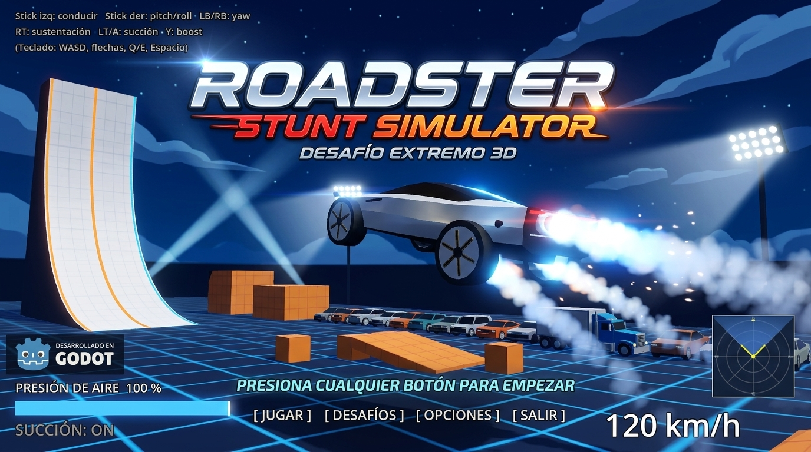
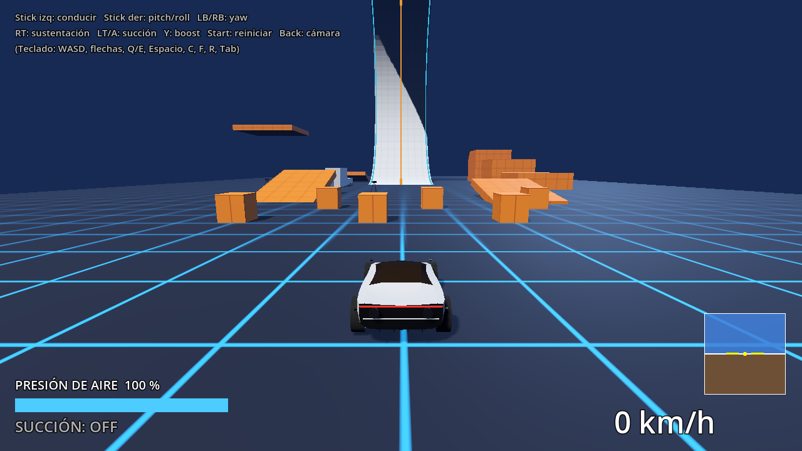

<div align="center">



# Roadster Stunt Simulator

**Desafío extremo 3D** · Un prototipo de conducción acrobática hecho en Godot 4

[](https://godotengine.org)
[](LICENSE)
[](https://github.com/AbelVicencio/roadster/releases/latest)

</div>

> [!WARNING]
> **Esto es solo una prueba de concepto.** Es un experimento personal y sin ánimo de lucro para explorar física de vehículos (propulsores y succión) en Godot. **No pretende ser un producto, un juego terminado ni nada más que eso.**
>
> - Es un prototipo: puede tener errores, un balance de dificultad por pulir y funciones incompletas. No se ofrece soporte ni garantía de que reciba actualizaciones.
> - **No está afiliado, patrocinado ni respaldado por Tesla, Inc., SpaceX ni ninguna otra empresa.** Cualquier parecido con productos reales es una referencia de fan; los nombres y marcas pertenecen a sus dueños.
> - La música y el arte de portada pertenecen a sus titulares y se incluyen solo a modo de demostración (ver [Aviso legal](#aviso-legal)).

Un deportivo con **propulsores de gas frío** y un **sistema de succión** capaz de pegarlo a rampas, paredes y techos. Lo difícil es el control: no hay estabilización automática, el aire comprimido se gasta rápido y se recarga despacio. Inspirado en la demo del Roadster de octubre de 2026.



## Descarga y juega (Windows)

1. Ve a **[Releases](https://github.com/AbelVicencio/roadster/releases/latest)** y descarga `RoadsterStunt.exe`.
2. Ábrelo con doble clic: es un único archivo autocontenido, sin instalación.

> Windows SmartScreen puede avisar de que el programa es de un "editor desconocido", porque el ejecutable no está firmado. Pulsa *Más información → Ejecutar de todas formas*. Si lo prefieres, compílalo tú mismo (ver abajo).

## Controles

| Acción | Gamepad | Teclado |
|---|---|---|
| Acelerar / frenar y girar | Stick izquierdo | `W` `S` / `A` `D` |
| Pitch y roll (actitud) | Stick derecho (arriba = morro abajo) | `↑` `↓` / `←` `→` |
| Yaw | `LB` / `RB` | `Q` / `E` |
| Sustentación + empuje trasero | `RT` | `Espacio` |
| Succión | `LT` o `A` | `C` |
| Boost de thrusters | `Y` | `F` |
| Reiniciar posición | `Start` | `R` |
| Cambiar cámara | `Back` | `Tab` |

En la portada, cualquier clic, tecla o botón inicia el juego.

## Cómo se juega

- **Succión:** con `LT` activo y una superficie cerca, el coche se pega con hasta 2 G. Acelera a fondo por la rampa curva: llega a vertical y sigue por el techo, boca abajo.
- **Thrusters:** 10 en total (4 verticales, 2 traseros, 4 laterales). Solo empujan, así que para inclinar hay que encender el lado contrario. La inercia es alta: un giro no se frena solo.
- **Aire:** 100 unidades compartidas entre thrusters y succión. Se recarga lentamente cuando no gastas.
- **Retos de la pista:** rampa en C, salto sobre una fila de coches y un camión, escalera de plataformas, plataforma flotante y un objetivo de aterrizaje.

## Ejecutar desde el código

Necesitas [Godot 4.3 o superior](https://godotengine.org/download) (probado en 4.7).

```bash
git clone https://github.com/AbelVicencio/roadster.git
cd roadster
godot --path .          # o abre la carpeta en el editor y pulsa F5
```

No hay dependencias externas. Todo el mundo (pista, coche, HUD, cámara) se genera por código al arrancar.

### Exportar tu propio `.exe`

1. *Editor → Administrar plantillas de exportación → Descargar e instalar*.
2. *Proyecto → Exportar…*: el preset *Windows Desktop* ya está configurado con **Embed PCK** (un solo archivo).
3. Exporta (o por consola):
   ```bash
   godot --headless --path . --export-release "Windows Desktop" build/RoadsterStunt.exe
   ```

## Estructura

```
scenes/main.tscn          escena principal (solo un nodo con main.gd)
scripts/
  main.gd                 entorno, pista, coche, cámara, HUD, audio y portada
  car.gd                  RigidBody3D: entradas, mezcla de thrusters, aire, reinicio
  car_model.gd            modelo visual del coche (generado por código)
  wheel.gd                rueda raycast: suspensión, tracción y agarre
  thruster.gd             propulsor de gas frío: fuerza + partículas
  suction_system.gd       succión: 5 raycasts y fuerza hacia la superficie
  track.gd                pista de pruebas
  chase_camera.gd         cámara de seguimiento (2 modos)
  hud.gd                  presión de aire, succión, velocidad y horizonte
  game_audio.gd           música y efectos de cohete sintetizados
  cover.gd                portada animada
  input_setup.gd          Input Map (gamepad + teclado)
assets/                   música y portada
docs/                     capturas
```

### Valores de física principales

| Parámetro | Valor |
|---|---|
| Masa | 1000 kg · gravedad 9.8 · física a 120 Hz |
| Thrusters | vertical 4000 N ×4 · trasero 6000 N ×2 · lateral 2500 N ×4 |
| Succión | 2 G máx., rango 1.2–3 m |
| Suspensión | k = 30000 N/m · amortiguación 3400 · mu 1.5 |
| Motor | 3500 N por rueda · 40 m/s máx. |

Casi todos están como `@export` en `car.gd`, `wheel.gd` y `suction_system.gd`. Para cambiar la dificultad, empieza por `attitude_gain` y `tank_capacity`.

### Audio

La música suena en bucle (volumen de portada y de juego en `game_audio.gd`: `music_volume_db`, `music_volume_game_db`). Los efectos de cohete (siseo, rugido, ventilador de succión) se sintetizan en tiempo real.

## Desarrollo

El código GDScript usa [gdtoolkit](https://github.com/Scony/godot-gdscript-toolkit). Hay un workflow de GitHub Actions listo en [`docs/lint-workflow.yml`](docs/lint-workflow.yml) (cópialo a `.github/workflows/`) para comprobarlo en cada push:

```bash
pip install "gdtoolkit==4.*"
gdformat scripts      # formatea
gdlint scripts        # lint
```

Los ajustes del editor están en `.editorconfig` (tabuladores en `.gd`, LF, UTF-8).

## Aviso legal

Prueba de concepto sin ánimo de lucro y sin otra pretensión que experimentar y aprender. Proyecto de fans, **no afiliado, patrocinado ni respaldado por Tesla, Inc. ni SpaceX**. *Tesla*, *Roadster* y otras marcas pertenecen a sus respectivos dueños. Desarrollado con [Godot Engine](https://godotengine.org) (MIT).

- **Código:** licencia [MIT](LICENSE).
- **Música** (`assets/audio/`) y **arte de portada** (`assets/cover/`): no están cubiertos por la licencia MIT y pertenecen a sus titulares; se incluyen para la demostración. Si eres titular de alguno y quieres que se retire, abre un *issue*.
